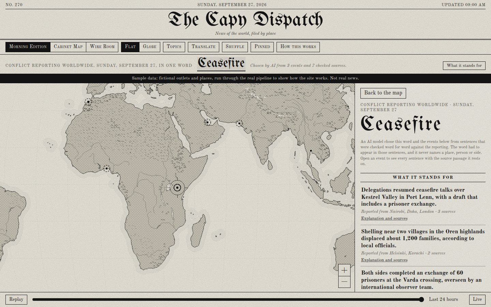
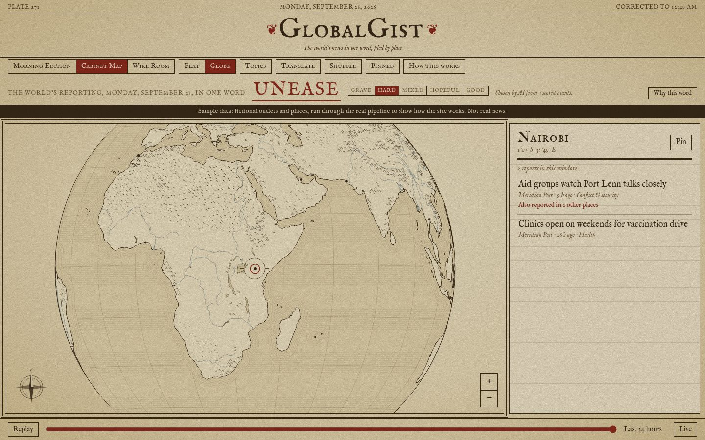
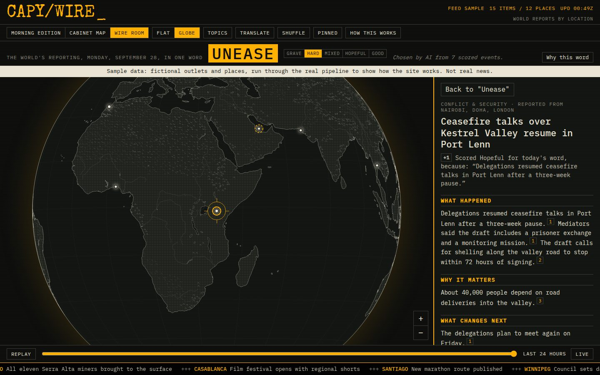
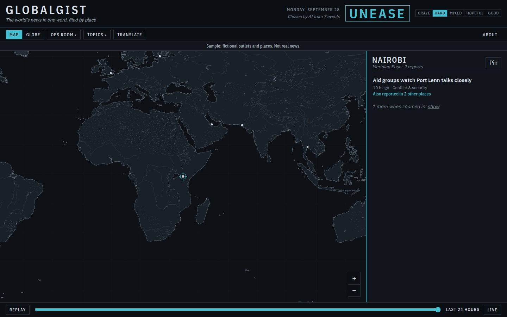
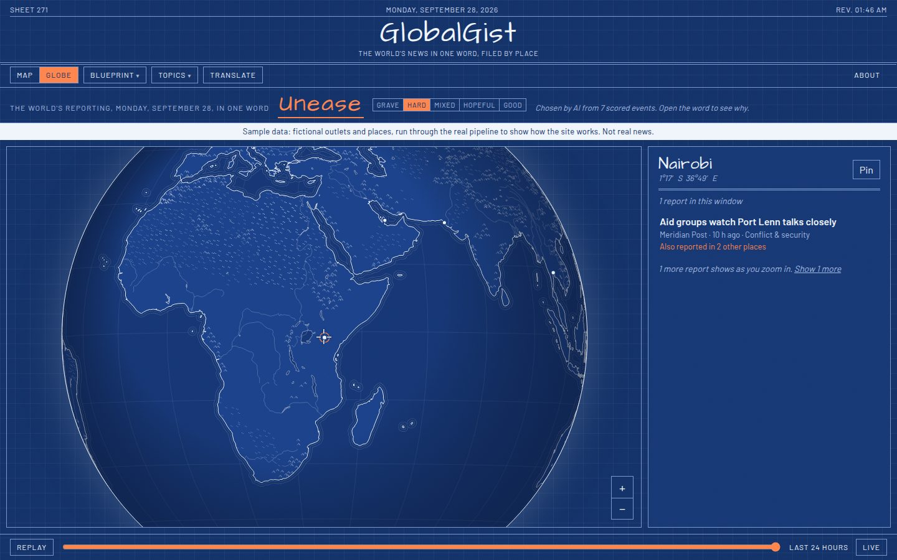

# capy

This repository holds two news products. Both read from one database that one pipeline writes (decisions 23 and 25 in docs/DECISIONS.md). Read CONTEXT.md first.

- **GlobalGist** is a public news map at globalgist.io. It places each day's world news where it happened and heads the page with one word for the day. The code is in `packages/map`, and the Worker in `packages/web` serves it.
- **2DayAI** sends each reader one headline a day by email. A hand-written interest profile picks the headline, and the stories, explanations and sources sit one click below it. It is built and tested but has not run live yet. The code is in `packages/core`, `db`, `pipeline` and `web`.

## GlobalGist

| Morning Edition | Cabinet Map | Wire Room |
|---|---|---|
|  |  |  |

| Ops Room | Blueprint |
|---|---|
|  |  |

The screenshots use the fictional sample day: made-up outlets and places, run through the real pipeline.

The idea comes from Radio Garden. When the page opens, the map turns until a place lands under the crosshair. You can turn the flat map or the globe yourself. The panel lists what outlets reported at the place under the crosshair, newest first. The map shows no borders, no country names and no labels.

- **The word.** Each day the `telegram` stage scores every explained world event from -2 to 2 by what happened to people. Each score quotes the sentence it rests on. Code then places the day on a five-step scale, from Severe harm to Resolution. The worst significant event sets a bad day, so good news never averages a tragedy away. The model picks the word from that step's fixed list, and the site shows every score with its reason.
- **Four levels of detail.** Under the word are the day's events, one line each. Each event opens to an explanation with numbered citations, and each citation opens to its source with the passage quoted. Headlines appear as the outlets published them.
- **Stories sit where they happened** (decisions 44 and 135). The grouping model names the city. Code looks that name up in the country the model named. It tries a fixed list of cities first, then a list of towns of 500 people or more. A story with no city that checks out stays at its outlet's city.
- **818 outlets in 746 places.** They cover nearly every country and territory, and also stateless nations, Indigenous communities and the regions of the ten most populous countries (decisions 31, 45, 48 and 49). The outlets are the `desk: world` entries in `config/sources.yaml`.
- **Local stories from towns.** Stories from GDELT's news index add towns the outlets do not reach (decisions 54, 67 and 78). They are read again every three hours (decision 80) and show only at the closest zoom.
- **Zoom shows more.** Zoomed out, the map shows the most important and most widely reported stories. Each step in adds the next of five tiers (decisions 30 and 46). A place's mark shows the model's 1 to 5 rating of its top story, and its size shows how many reports it has.
- **More:** 69 designs, Map or Globe view, a 24-hour replay, topic filters, place search, pinned places, and translation into about a hundred languages.

## 2DayAI

The design is in docs/SPEC.md. Later changes are in docs/DECISIONS.md, and running it is in docs/RUNBOOK.md.

### How it stays true to its sources

Every sentence of an explanation cites an article and a passage. Code checks that the passage appears word for word in that article and removes any sentence that fails. An event left with fewer than three sentences cannot be picked for anyone. The headline is written from the picked events' checked sentences, never from raw articles. The one paragraph written from a reader's profile instead of the sources is labelled as such on the page.

## Run it

You need Node 22. For 2DayAI, copy `.env.example` to `.env`.

```
npm install
npm run check                          # boundaries, typecheck and tests for every package. No network, no key.

# The map
npm run map:sample                     # the fictional day through the real stages, in memory, into the sample data
npm run map:dev                        # the site at http://localhost:5173 on the sample, with a banner
npm run stage -- map export            # the latest real day from DATABASE_URL, as the site sees it
npm run web:deploy                     # build the map and deploy it with the Worker (Cloudflare)

# 2DayAI
npm run stage -- sources check         # fetch every feed in config/sources.yaml and report
npm run db:migrate                     # apply migrations to DATABASE_URL
npm run stage -- day --date 2026-09-04 # ingest, enrich, readers sync, cluster, explain, select
npm run stage -- show --reader r01     # print that reader's edition for the date
npm run stage -- deliver --dry-run     # what would be sent right now
npm run stage -- spend                 # model spend for the date
npm run stage -- eval                  # compare model setups on one day's world articles
```

The model provider is a setting (decisions 28 and 29). The default is OpenAI's gpt-5.4-nano, with gpt-5.4-mini for the word. `npm run stage -- eval` compares models on one real day by cost, by the code checks, and by every score with its reason. See "Choose a model" in docs/RUNBOOK.md.

## Layout

- `packages/core`: types, Zod schemas, validators, renderers and versioned prompts. It imports nothing else in the workspace.
- `packages/db`: the Drizzle schema, migrations and shared read models. It imports core. `@2dayai/db/node` holds the postgres-js client.
- `packages/pipeline`: the stages, the CLI, and the model module in `src/llm/`, the only place that imports a model SDK. It imports core and db.
- `packages/web`: the Cloudflare Worker. It serves the map site and its data, the reader pages and feedback. It imports core and db.
- `packages/map`: the map site. It imports only core's types and reads its data from the Worker.
- `config/sources.yaml`: every feed, on the briefing desk (2DayAI) or the world desk (the map, with a place for each outlet).
- `config/readers/`: reader profiles. Git ignores all of them except the example.

`npm run lint` fails on any import that crosses these lines.

## Hosting

The Worker serves the map, its data and the reader pages on Cloudflare's free plan. Cloudflare's Git integration (Workers Builds) deploys it on each merge to main. The workflow `.github/workflows/deploy-site.yml` can deploy instead when `CLOUDFLARE_API_TOKEN` and `CLOUDFLARE_ACCOUNT_ID` are set. Use one or the other, not both (decision 38).

The daily run needs no deploy. It stores the day's file and its tiles of local stories in R2, and the Worker serves them (decisions 73 and 78).

The repository is public, so GitHub Actions minutes are free (decision 130). On a private repository the jobs would pass the 2,000 free minutes a month:

- the daily run, about 20 minutes
- the refresh every three hours, about 3 to 5 minutes each
- CI on each pull request
- the site check (`site-check.yml`, decision 85), about a minute a day

The free Workers plan allows 100,000 requests a day. Each visit loads the day's file in one request. A visitor who zooms all the way in also loads the tiles in view, usually 5 to 25 more. At about 20 tile requests per such visitor, that leaves room for about 4,000 of them a day. Past that, the paid plan costs 5 USD a month for 10 million requests.
